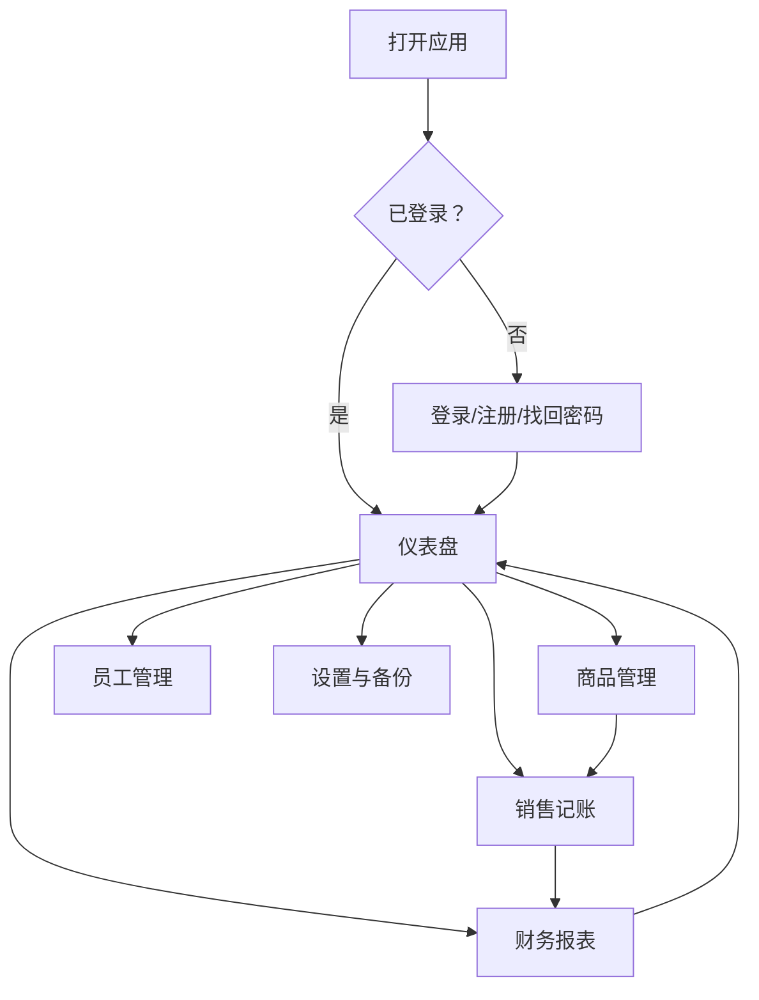
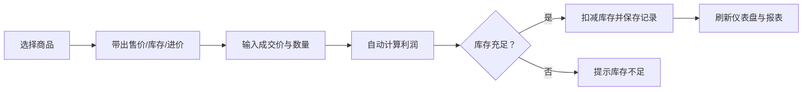

# 服装店记账本产品需求文档（PRD）

## 1. 产品概述

“衣账本”是一款面向服装店店主与员工的轻量级网页记账应用，帮助用户高效管理商品、库存、销售与营收。它支持多账户权限、库存预警、销售趋势分析，并提供本地备份机制，确保经营数据安全可用。

目标用户为中小型服装店、个体店主及店员，核心痛点是替代手工记账、避免库存混乱、快速掌握每日盈亏。

## 2. 核心功能

### 2.1 用户角色

| 角色 | 注册/创建方式 | 核心权限 |
|------|---------------|----------|
| 店主（owner） | 注册时自动成为店主 | 全部权限：商品管理、销售记账、报表查看、员工管理、数据备份、系统设置 |
| 员工（staff） | 店主在“员工管理”中添加 | 仅可添加销售记录、查看商品库存与当日营收，不可删除/修改商品、查看完整财务报表、备份数据 |
| 访客 | 未登录 | 仅可访问登录/注册/找回密码页面 |

### 2.2 功能模块

1. **登录与注册页**：账号注册、登录、记住登录状态、密码找回、安全退出。
2. **仪表盘（首页）**：今日营收卡片、库存预警列表、快捷操作入口、最近销售记录。
3. **商品管理页**：商品增删改查、型号/库存实时展示、分类筛选、二次确认删除。
4. **销售记账页**：选择商品、输入售价/数量、自动计算利润、提交销售记录。
5. **财务报表页**：按日/周/月查看销售额、成本、利润；销售趋势图表；商品销量排行。
6. **员工管理页**（店主可见）：添加员工账号、设置角色、启用/禁用账号。
7. **设置与备份页**：商品分类管理、库存预警阈值设置、手动导出/导入 JSON 备份、自动备份开关。

### 2.3 页面详情

| 页面名称 | 模块名称 | 功能描述 |
|----------|----------|----------|
| 登录页 | 登录表单 | 用户名/密码登录、记住我、跳转注册/找回密码 |
| 注册页 | 注册表单 | 用户名、邮箱、密码、确认密码、角色默认店主 |
| 找回密码 | 密码重置 | 通过邮箱发送重置链接（集成 Supabase Auth） |
| 仪表盘 | 今日概览 | 销售额、成本、利润、订单数四张卡片 |
| 仪表盘 | 库存预警 | 低于阈值的商品列表，支持跳转补货 |
| 仪表盘 | 最近销售 | 最近 5 条销售记录，显示商品与金额 |
| 商品管理 | 商品列表 | 卡片/表格双视图，展示名称、型号、颜色、尺码、进价、售价、库存 |
| 商品管理 | 商品编辑抽屉 | 新增/编辑商品，字段完整校验 |
| 商品管理 | 删除确认弹窗 | 二次确认，防止误删 |
| 销售记账 | 销售表单 | 下拉选择商品、输入数量与成交价、自动计算利润 |
| 财务报表 | 时间筛选 | 日/周/月快捷切换，自定义日期范围 |
| 财务报表 | 趋势图 | 折线图展示销售额/利润趋势 |
| 财务报表 | 排行榜 | 销量/销售额 Top 商品 |
| 员工管理 | 员工列表 | 展示员工账号、角色、状态，支持启用/禁用 |
| 设置与备份 | 分类管理 | 添加/删除商品分类 |
| 设置与备份 | 库存预警设置 | 设置全局低库存阈值 |
| 设置与备份 | 数据备份 | 导出全部数据为 JSON、导入 JSON 恢复、开启本地自动备份 |

## 3. 核心流程

### 3.1 登录后使用流程

用户打开应用后，先进入登录页。登录成功后根据角色跳转到仪表盘。店主可在仪表盘查看今日营收、库存预警和最近销售，随后进入商品管理录入服装信息，或在销售记账页记录交易。每日/每周/每月可在财务报表页查看趋势与排行。店主还可在员工管理页添加店员账号，在设置页管理分类、预警阈值和数据备份。

### 3.2 销售记账流程

用户在销售记账页选择商品，系统自动带出默认售价与当前库存。输入实际成交价和数量后，系统根据商品进价计算利润。提交后更新库存并生成销售记录，仪表盘和报表实时刷新。

## 4. 用户界面设计

### 4.1 设计风格

- **主色调**：温润米白 `#F7F5F2` 作为背景，深炭灰 `#2D2A26` 作为主文字色，陶土红 `#C45C3E` 作为强调色，金棕色 `#B89B72` 用于次要强调与图标。
- **按钮风格**：大圆角（`border-radius: 12px`），主按钮使用陶土红背景 + 白色文字，悬停时微缩放与阴影；危险操作使用金棕色边框的幽灵按钮。
- **字体搭配**：标题使用衬线中文字体 **Noto Serif SC**，营造精品店的高级感；正文使用 **Noto Sans SC**，保证小屏幕可读性；数字使用等宽字体 **JetBrains Mono**，便于金额对齐。
- **布局风格**：桌面端采用左侧固定侧边栏 + 右侧内容区的经典管理后台布局；移动端采用底部标签栏，内容区使用卡片堆叠。
- **图标风格**：线性图标（Lucide），细线、统一 1.5px 描边，颜色跟随文字层级。

### 4.2 页面设计概览

| 页面名称 | 模块名称 | UI 元素 |
|----------|----------|---------|
| 登录页 | 登录卡片 | 居中卡片、品牌 Logo、表单输入框、主按钮、辅助链接 |
| 仪表盘 | 数据卡片 | 四列网格卡片、大字号金额、环比提示 |
| 仪表盘 | 预警列表 | 横向滚动列表、低库存标签、补货按钮 |
| 商品管理 | 商品卡片 | 图片占位、名称/型号/库存、编辑/删除图标 |
| 销售记账 | 表单 | 商品搜索选择器、数字输入、实时利润预览 |
| 财务报表 | 图表区 | 折线图 + 柱状图组合、时间筛选胶囊按钮 |
| 设置页 | 分类管理 | 标签式输入、可删除分类 Tag |

### 4.3 响应式策略

- **桌面端优先**：默认 1280px 及以上显示左侧 240px 侧边栏，内容区最大宽度 1200px 居中。
- **平板适配**：768px–1279px 隐藏侧边栏文字仅保留图标，或切换为顶部导航；表格转为卡片列表。
- **移动端优化**：小于 768px 使用底部固定 5 项标签栏（仪表盘、商品、记账、报表、我的），内容区底部预留 72px 安全区；所有表单改为单列，按钮全宽；抽屉/弹窗占满屏幕底部滑出。
- **触控优化**：按钮最小点击区域 44×44px，表格行增大内边距，数字输入使用带加减步进器的自定义控件。

### 4.4 动效与微交互

- 页面加载：仪表盘卡片依次淡入上浮，stagger 间隔 80ms。
- 数据更新：数字使用计数动画过渡，销售提交成功后按钮显示对勾并短暂禁用。
- 库存预警：低库存商品左侧边框脉冲高亮。
- 删除确认：弹窗从底部滑入并带背景模糊遮罩。
- 路由切换：内容区使用 200ms 淡入淡出，移动端使用滑动过渡。
