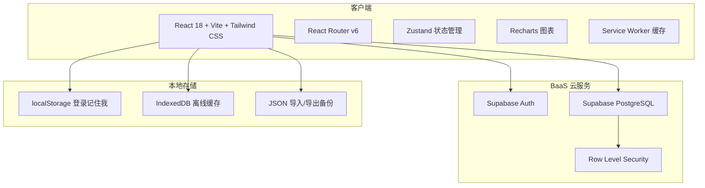
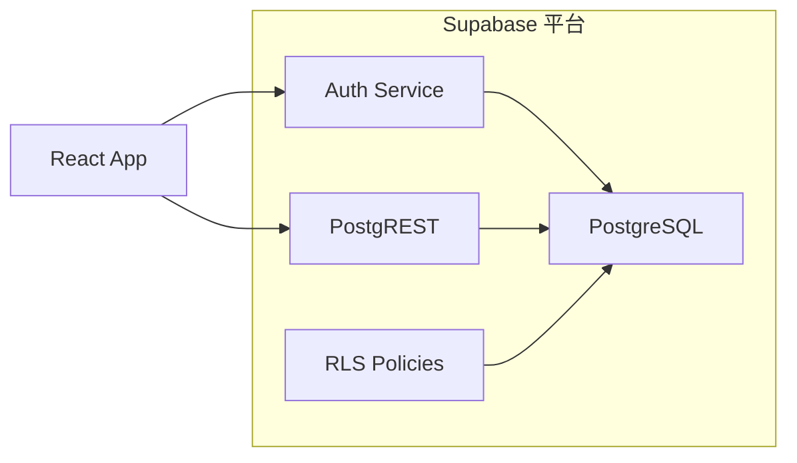
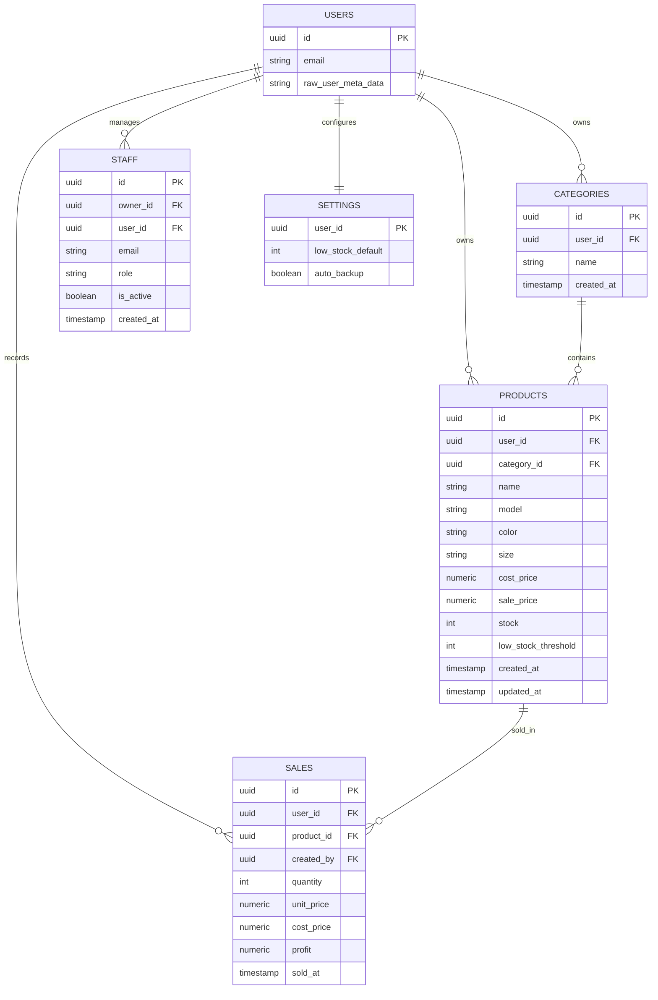

# 服装店记账本技术架构文档

## 1. 架构设计

应用采用**无服务器前端优先（Serverless-First）**架构：React 单页应用通过 Supabase 客户端直接调用认证与数据库服务，所有业务数据持久化到 Supabase PostgreSQL，并通过 Row Level Security 保障多租户安全。本地通过 IndexedDB / localStorage 实现离线缓存与手动备份，Service Worker 负责静态资源缓存以提升加载速度。



## 2. 技术选型

- **前端框架**：React 18（函数组件 + Hooks）
- **构建工具**：Vite 5
- **类型系统**：TypeScript 5
- **样式方案**：Tailwind CSS 3 + 自定义 CSS 变量
- **路由**：React Router v6
- **状态管理**：Zustand（轻量、无样板代码）
- **图标**：Lucide React
- **图表**：Recharts
- **后端/数据库**：Supabase（免费套餐）
  - Auth：负责注册、登录、密码找回、JWT 会话
  - PostgreSQL：存储用户、商品、销售记录、分类、员工关系
  - RLS：按 `user_id` 与 `role` 控制数据访问
- **本地持久化**：
  - localStorage：记住登录状态标记
  - IndexedDB：dexie.js 缓存商品与销售记录，支持离线查看
- **部署**：Vercel / Netlify（静态托管，免费）

## 3. 路由定义

| 路由 | 用途 | 访问权限 |
|------|------|----------|
| `/login` | 登录页 | 访客 |
| `/register` | 注册页 | 访客 |
| `/forgot-password` | 找回密码页 | 访客 |
| `/reset-password` | 密码重置确认页 | 访客（需 token） |
| `/dashboard` | 仪表盘首页 | 登录用户 |
| `/products` | 商品管理 | 登录用户 |
| `/sales` | 销售记账 | 登录用户 |
| `/reports` | 财务报表 | 店主 |
| `/staff` | 员工管理 | 店主 |
| `/settings` | 设置与备份 | 店主 |
| `*` | 404 页面 | 全部 |

## 4. API 定义

应用主要使用 Supabase 自动生成的 REST API。以下为自定义业务类型：

```typescript
// 商品
interface Product {
  id: string;
  user_id: string;
  name: string;
  model: string;
  color: string;
  size: string;
  category_id: string;
  cost_price: number;   // 进价
  sale_price: number;   // 售价
  stock: number;
  low_stock_threshold: number;
  created_at: string;
  updated_at: string;
}

// 销售记录
interface Sale {
  id: string;
  user_id: string;
  product_id: string;
  quantity: number;
  unit_price: number;   // 实际成交价
  cost_price: number;   // 当时进价快照
  profit: number;
  sold_at: string;
  created_by: string;   // 记录人
}

// 商品分类
interface Category {
  id: string;
  user_id: string;
  name: string;
}

// 员工关系（店主视角）
interface Staff {
  id: string;
  owner_id: string;
  user_id: string;
  email: string;
  role: 'staff';
  is_active: boolean;
  created_at: string;
}

// 系统设置
interface AppSetting {
  user_id: string;
  low_stock_default: number;
  auto_backup: boolean;
}
```

## 5. 服务端架构

本应用不自行搭建后端服务器，全部服务端能力由 Supabase 提供：



- **Auth Service**：处理密码哈希、邮箱验证、JWT 签发与刷新、密码重置。
- **PostgREST**：将 PostgreSQL 表自动暴露为 RESTful API。
- **RLS Policies**：每张业务表启用 RLS，策略基于 `auth.uid()` 与 `role`，确保用户只能读写自己的数据。

## 6. 数据模型

### 6.1 ER 图



### 6.2 建表 SQL（Supabase）

```sql
-- 启用扩展
CREATE EXTENSION IF NOT EXISTS "uuid-ossp";

-- 商品分类
CREATE TABLE categories (
  id UUID PRIMARY KEY DEFAULT uuid_generate_v4(),
  user_id UUID NOT NULL REFERENCES auth.users(id) ON DELETE CASCADE,
  name TEXT NOT NULL,
  created_at TIMESTAMPTZ DEFAULT now()
);

-- 商品
CREATE TABLE products (
  id UUID PRIMARY KEY DEFAULT uuid_generate_v4(),
  user_id UUID NOT NULL REFERENCES auth.users(id) ON DELETE CASCADE,
  category_id UUID REFERENCES categories(id) ON DELETE SET NULL,
  name TEXT NOT NULL,
  model TEXT NOT NULL,
  color TEXT NOT NULL,
  size TEXT NOT NULL,
  cost_price NUMERIC(12,2) NOT NULL,
  sale_price NUMERIC(12,2) NOT NULL,
  stock INTEGER NOT NULL DEFAULT 0,
  low_stock_threshold INTEGER NOT NULL DEFAULT 5,
  created_at TIMESTAMPTZ DEFAULT now(),
  updated_at TIMESTAMPTZ DEFAULT now()
);

-- 销售记录
CREATE TABLE sales (
  id UUID PRIMARY KEY DEFAULT uuid_generate_v4(),
  user_id UUID NOT NULL REFERENCES auth.users(id) ON DELETE CASCADE,
  product_id UUID NOT NULL REFERENCES products(id) ON DELETE RESTRICT,
  created_by UUID NOT NULL REFERENCES auth.users(id),
  quantity INTEGER NOT NULL CHECK (quantity > 0),
  unit_price NUMERIC(12,2) NOT NULL,
  cost_price NUMERIC(12,2) NOT NULL,
  profit NUMERIC(12,2) NOT NULL,
  sold_at TIMESTAMPTZ DEFAULT now()
);

-- 员工关系
CREATE TABLE staff (
  id UUID PRIMARY KEY DEFAULT uuid_generate_v4(),
  owner_id UUID NOT NULL REFERENCES auth.users(id) ON DELETE CASCADE,
  user_id UUID NOT NULL REFERENCES auth.users(id) ON DELETE CASCADE,
  email TEXT NOT NULL,
  role TEXT NOT NULL DEFAULT 'staff',
  is_active BOOLEAN NOT NULL DEFAULT true,
  created_at TIMESTAMPTZ DEFAULT now()
);

-- 设置
CREATE TABLE settings (
  user_id UUID PRIMARY KEY REFERENCES auth.users(id) ON DELETE CASCADE,
  low_stock_default INTEGER NOT NULL DEFAULT 5,
  auto_backup BOOLEAN NOT NULL DEFAULT false
);

-- 更新时间戳触发器
CREATE OR REPLACE FUNCTION update_updated_at_column()
RETURNS TRIGGER AS $$
BEGIN
  NEW.updated_at = now();
  RETURN NEW;
END;
$$ LANGUAGE plpgsql;

CREATE TRIGGER update_products_updated_at
BEFORE UPDATE ON products
FOR EACH ROW EXECUTE FUNCTION update_updated_at_column();
```

### 6.3 RLS 策略示例

```sql
-- 业务表仅允许所有者或授权员工访问
ALTER TABLE products ENABLE ROW LEVEL SECURITY;

CREATE POLICY "owner_full_access" ON products
  FOR ALL
  TO authenticated
  USING (user_id = auth.uid());

CREATE POLICY "staff_read_access" ON products
  FOR SELECT
  TO authenticated
  USING (
    EXISTS (
      SELECT 1 FROM staff
      WHERE staff.owner_id = products.user_id
        AND staff.user_id = auth.uid()
        AND staff.is_active = true
    )
  );
```

## 7. 安全策略

1. **密码安全**：使用 Supabase Auth 默认 bcrypt 哈希，前端绝不存储明文密码。
2. **会话安全**：JWT 存储于内存（Zustand），刷新 token 由 Supabase 自动管理；“记住我”仅保存一个非敏感标记到 localStorage，实际会话仍由 HTTP-only cookie 维护。
3. **数据隔离**：所有业务表启用 RLS，店主只能访问自己的数据，员工通过 `staff` 表获得授权后只能读取/写入指定数据。
4. **输入校验**：前端使用 Zod 对表单进行校验；后端通过 PostgreSQL CHECK 约束与 RLS 进行二次校验。
5. **常见攻击防护**：
   - XSS：React 自动转义， dangerouslySetInnerHTML 禁用。
   - CSRF：Supabase 使用 cookie + JWT，跨域由 Supabase 配置控制。
   - SQL 注入：通过 Supabase 客户端参数化查询，禁止手写 SQL。
   - 暴力破解：利用 Supabase Auth 速率限制。

## 8. 性能策略

- 使用 Vite 代码分割，按路由懒加载页面组件。
- Service Worker 缓存构建产物，二次访问实现秒开。
- 图表数据通过 SQL 聚合（如 `date_trunc`）返回，避免前端大量计算。
- IndexedDB 缓存商品列表，离线场景可查看最近数据。
- 图片/图标使用 SVG，无额外资源请求。
